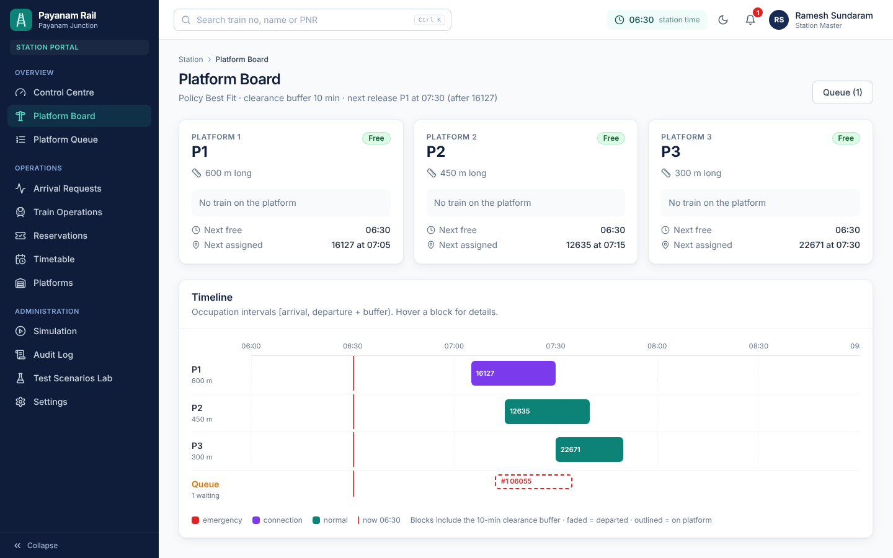
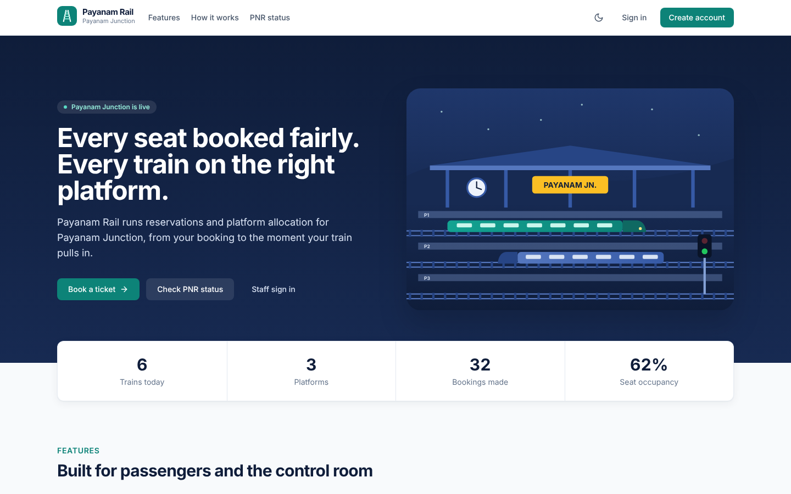
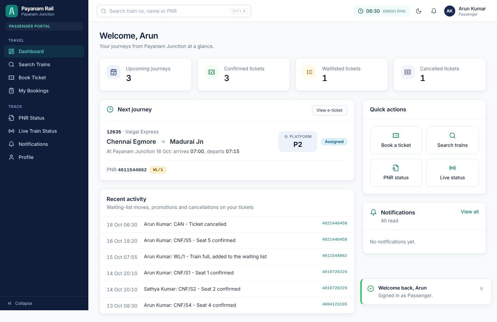
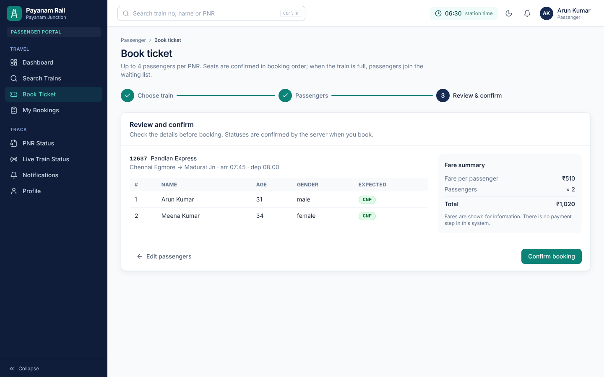
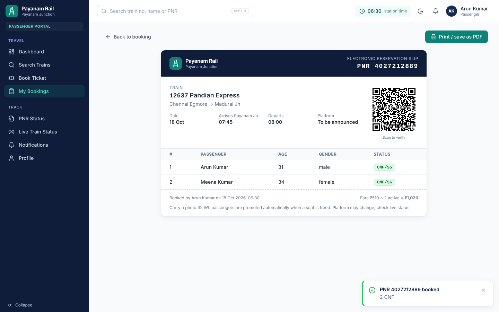
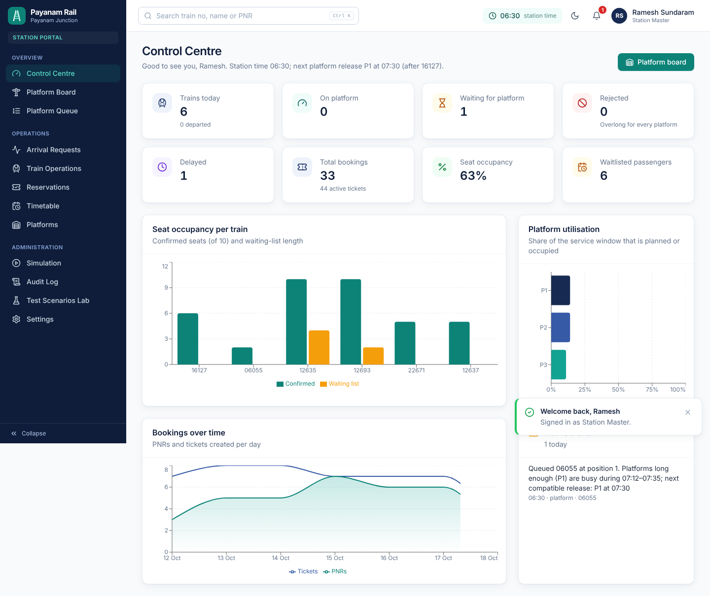
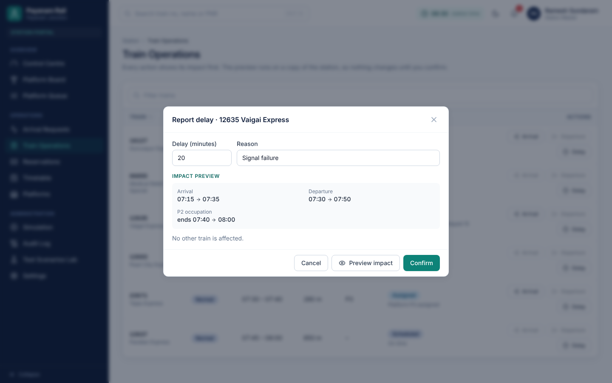
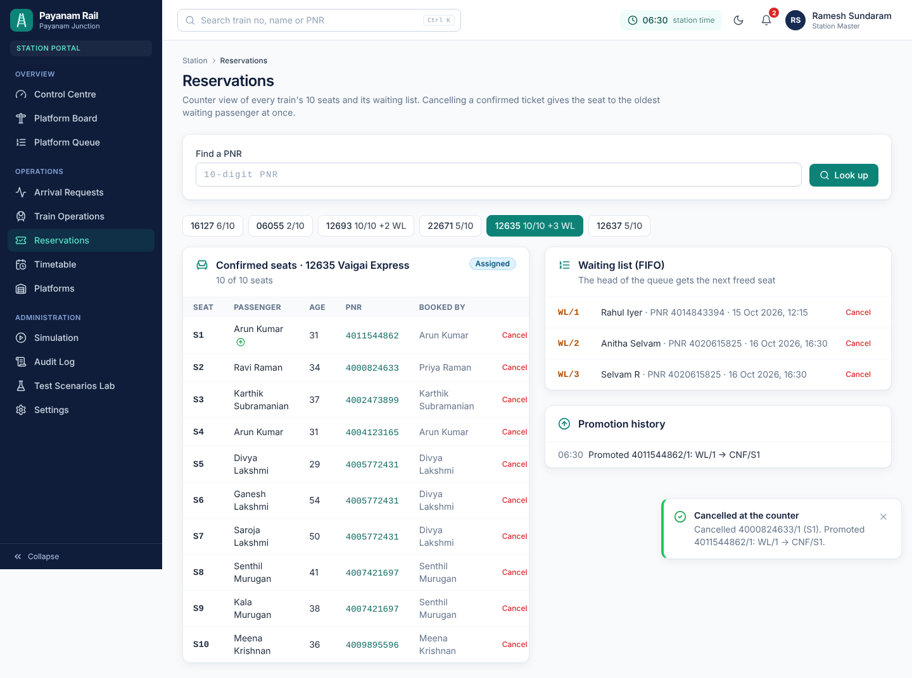
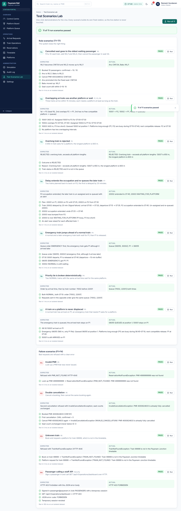

# Payanam Rail

**Railway Reservation and Platform Allocation System** for *Payanam Junction*, a fictional single station
(Mini Project 16 · Java, Object-Oriented Programming, Data Structures).

Passengers book seats on six trains with ten seats each. When someone cancels, the oldest waitlisted passenger gets
that exact seat immediately. Station staff allocate three platforms so that no two trains ever overlap, with emergency
and connecting trains served first, and the plan re-calculates itself when a train is delayed.



* **Core logic in plain Java on hand-written data structures:** HashMap, ArrayDeque (FIFO waiting list),
  PriorityQueue (platform queue), a min-heap of release times and sorted ArrayLists with binary-search insert.
* **OOP:** encapsulated rules (`bookSeat`, `cancelBooking`, `occupyPlatform`), an abstract `PlatformRequest` with
  polymorphic `priorityRank()`, a `PlatformAllocationPolicy` interface (Best Fit / First Fit), composition, enums and
  custom exceptions.
* **Web app:** Spring Boot 3 REST API with JWT, BCrypt and roles; React 18 passenger and station portals; Swagger UI.
* **Quality:** 129 JUnit tests passing, 95–100% line coverage of domain and service, and an in-app Test Lab (T1–T7,
  F1–F4).

## Prerequisites

| Tool | Version | Notes |
|---|---|---|
| JDK | **17 or newer** | The only thing you must install. Check with `java -version`. |
| Maven | not needed | The Maven Wrapper (`mvnw`, `mvnw.cmd`) downloads Maven. |
| Node.js | not needed for the normal run | Maven downloads Node 20 into `backend/target` to build the frontend. Install Node 20+ only for frontend dev mode. |
| Internet | first build only | To download Maven, Node and the dependencies. |

## Fastest way: the ready-to-run build

If you downloaded `payanam-rail-full.zip`, the `release/` folder has `payanam-rail-1.0.0.jar` with the backend, all
libraries and the built frontend inside. With Java 17+ installed, double-click `release/start-windows.bat` (Windows)
or run `release/start-mac-linux.sh` (Mac/Linux), then open <http://localhost:8080>. Nothing else to install.

## Run it from source (one command)

```bash
cd payanam-rail/backend
./mvnw spring-boot:run          # Windows: mvnw.cmd spring-boot:run
```

Then open **<http://localhost:8080>**.

The first run takes a few minutes (it downloads dependencies and builds the React app). Later runs are quicker.
Swagger UI is at **<http://localhost:8080/swagger-ui.html>**.

## Demo accounts

| Role | Email | Password | Can do |
|---|---|---|---|
| Passenger | `passenger@payanam.in` | `Passenger@123` | Passenger portal (Arun Kumar, already WL/1 on Vaigai Express) |
| Station Master | `stationmaster@payanam.in` | `Station@123` | Everything in the station portal |
| Platform Controller | `controller@payanam.in` | `Station@123` | Platforms, trains, arrivals, delays, simulation |
| Booking Clerk | `clerk@payanam.in` | `Station@123` | Reservations only |

Every seeded passenger (for example `priya.raman@example.in`) uses `Passenger@123`. You can sign in with the email or
the 10-digit mobile number. To register a new staff account, use the station access code **`PAYANAM-2026`**, an
employee id like `PJ-EMP-2001` and an `@payanam.in` email.

## Other commands

All backend commands run from `backend/`.

| Task | Command |
|---|---|
| Run the backend tests (+ coverage check) | `./mvnw test` |
| Coverage report | open `backend/target/site/jacoco/index.html` after `./mvnw test` |
| Build a runnable jar | `./mvnw package` then `java -jar target/payanam-rail-1.0.0.jar` |
| Backend only, skip the React build | add `-Dskip.frontend=true` to any command |
| Use another port | `./mvnw spring-boot:run -Dspring-boot.run.arguments=--server.port=9090` |
| Reset accounts and the audit log | stop the app, delete `backend/data/`, start again (the seed accounts are re-created) |
| Reset trains and bookings | Station → Simulation → **Load seed data** (or restart the app) |

### Frontend dev mode (hot reload)

```bash
# terminal 1
cd backend && ./mvnw spring-boot:run -Dskip.frontend=true

# terminal 2 (Node 20+)
cd frontend
npm install
npm run dev        # http://localhost:5173, proxies /api to 8080
npm test           # Vitest unit tests
npm run build      # type-check and production build into frontend/dist
```

## How to try the main rules

| Rule | Where to see it |
|---|---|
| R1/R2 book 1–4 passengers, CNF then WL | Passenger → Book Ticket on *Tejas Express* (seats left) and *Pearl City Express* (full) |
| R3 cancel → oldest WL promoted | Station → Reservations → Vaigai → cancel seat S1: Arun Kumar goes WL/1 → CNF/S1 and is notified |
| P2 overlong train rejected | Station → Arrival Requests → Pandian Express 12637 (650 m) |
| P3/P4 queue by priority | Station → Platform Queue: the emergency train is first |
| P7 delay re-plans | Station → Train Operations → Delay → *Preview impact* → Confirm |
| P8 departure frees the platform | Simulation +30 min → confirm arrival and departure of Vaigai: the queue is allocated |
| Everything at once | Station → Test Lab → **Run all** (11/11 PASS) |

The full 10-minute walkthrough is in [docs/demo-script.md](docs/demo-script.md).

## Why there is a database

The case study does not need one, and the reservation and platform logic never uses it: trains, PNRs, platforms and
queues live in in-memory Java collections. A real sign-in system does need persistent accounts, so an H2 database in
file mode (`backend/data/`) stores only user accounts, sign-in sessions, password-reset OTPs, the audit log and saved
snapshots. Restarting the server reloads the seed station day at 06:30; accounts and the audit log are kept.

## Folder structure

```
payanam-rail/
├─ README.md
├─ backend/                         Spring Boot 3, Java 17, Maven Wrapper
│  ├─ pom.xml                       builds the frontend too (frontend-maven-plugin)
│  └─ src/
│     ├─ main/java/com/payanam/rail/
│     │  ├─ config/                 security, OpenAPI, properties, SPA fallback
│     │  ├─ security/               JWT service and filter, JSON 401/403 handlers
│     │  ├─ controller/             12 REST controllers under /api/v1
│     │  ├─ dto/                    request/response records (domain objects never leave the services)
│     │  ├─ service/                use cases, StationService (lock + previews), testlab/
│     │  ├─ domain/model/           TrainService, Reservation, Platform, PlatformRequest + subclasses, enums
│     │  ├─ domain/engine/          RailwayStation, ReservationDesk, PlatformScheduler, TrainRegistry, clock
│     │  ├─ domain/policy/          PlatformAllocationPolicy, BestFit, FirstFit
│     │  ├─ domain/user/, audit/    JPA entities (accounts, sessions, audit, snapshots)
│     │  ├─ repository/             Spring Data JPA (users and audit only)
│     │  ├─ exception/              custom exceptions + GlobalExceptionHandler
│     │  └─ seed/                   loads src/main/resources/seed/*.json
│     ├─ main/resources/            application.yml, seed/*.json
│     └─ test/java/                 129 JUnit 5 / Mockito / Spring Boot tests
├─ frontend/                        React 18 + TypeScript + Vite + Tailwind
│  └─ src/
│     ├─ api/                       Axios client (JWT interceptor), endpoints, types
│     ├─ components/ui/             design system: buttons, cards, tables, badges, modals, toasts, skeletons
│     ├─ components/{layout,booking,station,brand}/
│     ├─ layouts/                   PublicLayout, PassengerLayout, StationLayout
│     ├─ pages/auth/, passenger/, station/
│     ├─ context/                   AuthContext, ThemeContext, ToastContext
│     ├─ hooks/, lib/, routes/      useApi, formatting, validation, Gantt maths, route guards
│     └─ main.tsx, App.tsx
└─ docs/
   ├─ problem-analysis.md           problem, assumptions, rules R1–R6 and P1–P9
   ├─ uml-class-diagram.md / .puml  class diagrams (Mermaid / PlantUML)
   ├─ architecture.md / .puml       component diagram + sequence diagrams
   ├─ diagrams/                     rendered PNGs of the PlantUML diagrams
   ├─ data-structures.md            each structure, where, Big-O, why
   ├─ api.md                        endpoints with real sample requests and responses
   ├─ test-results.md               rule table + every test with its status
   ├─ project-report.md             full project report
   ├─ demo-script.md                10-minute presentation flow
   ├─ viva-questions.md             30 questions with short answers
   └─ screenshots/                  screens of both portals
```

## Screenshots

| | |
|---|---|
|  Landing |  Passenger dashboard |
|  Booking wizard |  E-ticket with QR code |
|  Control Centre |  Delay impact preview |
|  Reservations and FIFO list |  Test Lab |

All screens are listed in the [screenshot checklist](docs/project-report.md#6-screenshot-checklist).

## Configuration

`backend/src/main/resources/application.yml`; every value can be overridden with an environment variable
(for example `PAYANAM_STATION_ACCESS_CODE`, `PAYANAM_SECURITY_JWT_SECRET`, `SERVER_PORT`).

| Key | Default | Meaning |
|---|---|---|
| `payanam.station.clearance-buffer-minutes` | 10 | Platform occupation = `[arrival, departure + buffer)` |
| `payanam.station.allocation-policy` | `BEST_FIT` | or `FIRST_FIT` (also switchable in Settings) |
| `payanam.station.clock-start` | `06:30` | Simulation clock start on the service day |
| `payanam.station.access-code` | `PAYANAM-2026` | Needed for staff registration |
| `payanam.security.jwt-expiry-minutes` | 60 | 7 days with *remember me* |
| `payanam.security.max-failed-attempts` / `lockout-minutes` | 5 / 15 | Account lockout |

The JWT secret and access code in `application.yml` are demo values; replace them through environment variables for
any real deployment.

## Troubleshooting

| Symptom | Fix |
|---|---|
| `JAVA_HOME is not set` or Java 11 is found | Install JDK 17+ and point `JAVA_HOME` at it |
| `Permission denied: ./mvnw` | `chmod +x mvnw` |
| Port 8080 already in use | Stop the other program or use `--server.port=9090` (see above) |
| Blank page at :8080 after a backend-only build | You used `-Dskip.frontend=true`; run without it once |
| Locked out of a demo account | Wait 15 minutes or delete `backend/data/` and restart |
