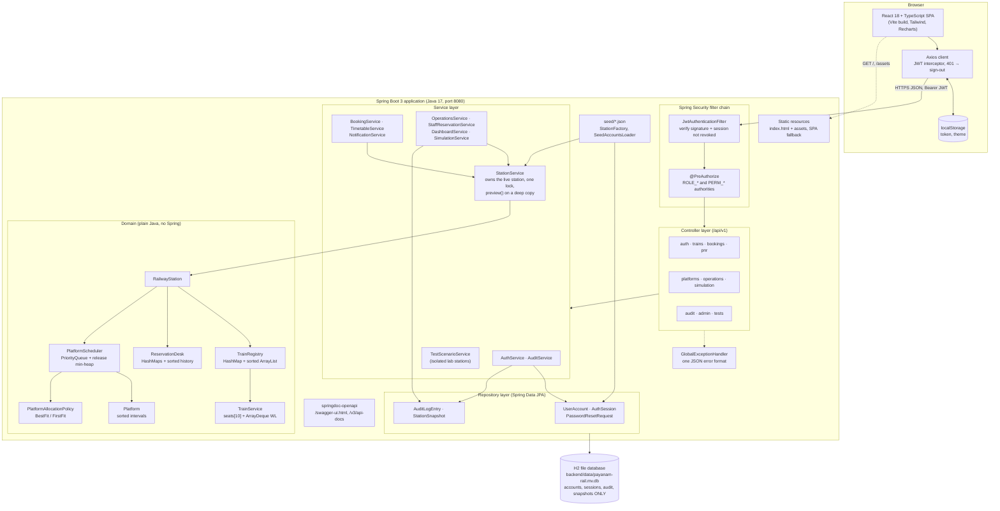
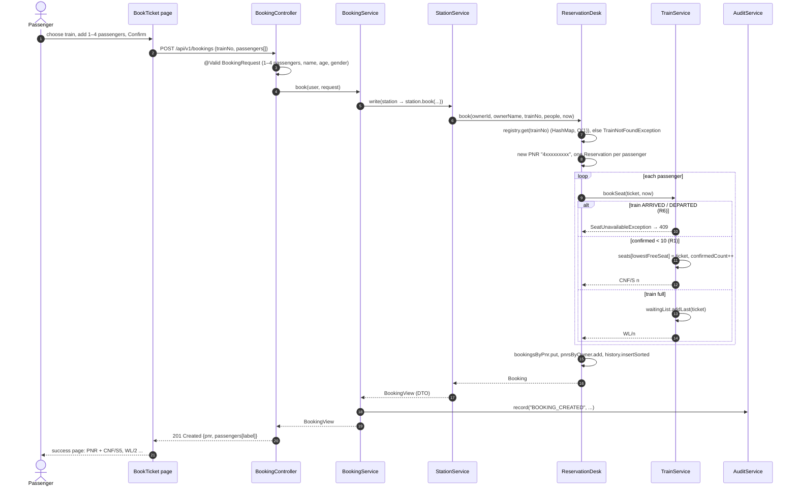
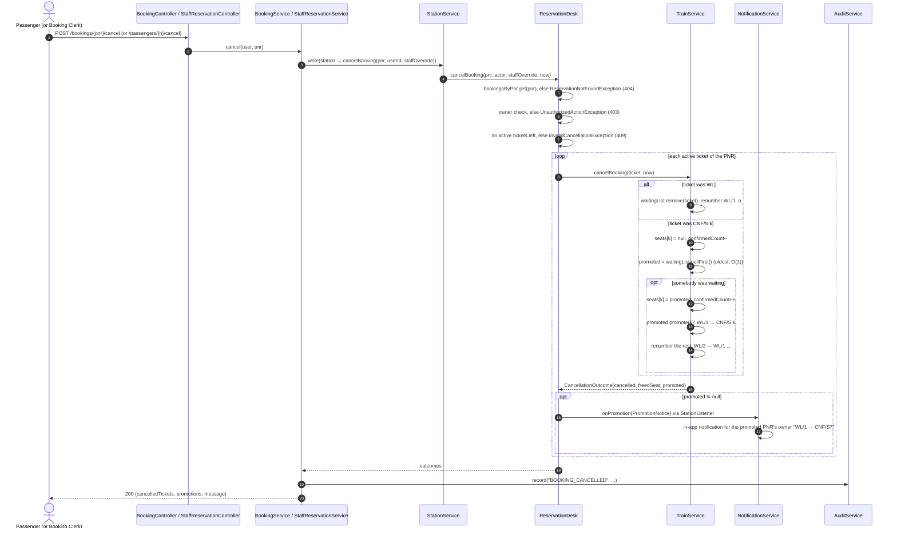
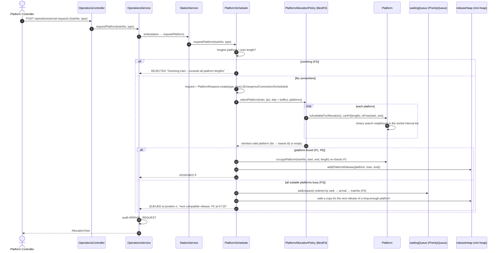
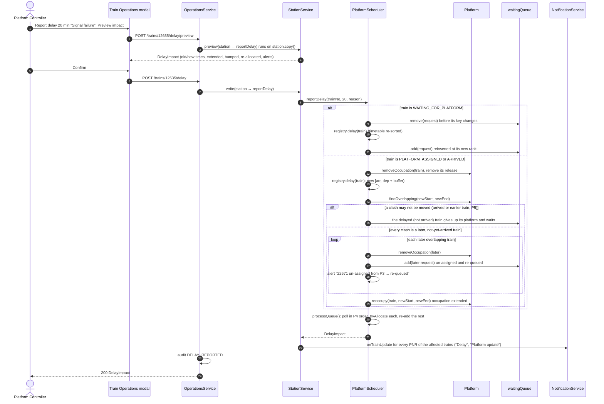
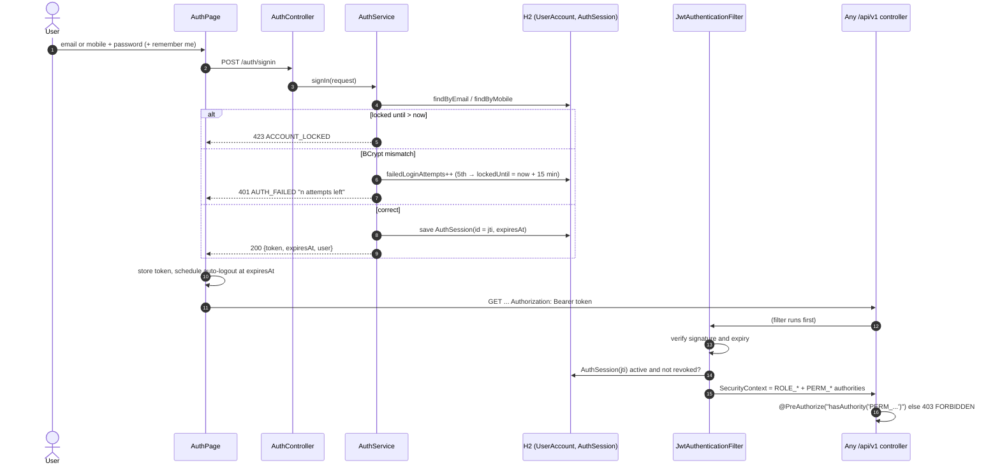

# Architecture and sequence diagrams

PlantUML versions of every diagram on this page are in [architecture.puml](architecture.puml).
The class diagrams are in [uml-class-diagram.md](uml-class-diagram.md).

## 1. Component diagram

One Spring Boot process serves the React single-page app, the REST API and Swagger UI on port 8080. The React build is
produced by Maven (frontend-maven-plugin) and copied into the jar's `static/` folder, so `./mvnw spring-boot:run` is
the only command needed.

### Layers and their rules

| Layer | Package | Responsibility | Rule |
|---|---|---|---|
| Controller | `controller` | HTTP mapping, `@Valid` request DTOs, `@PreAuthorize` | No business logic; returns DTOs only |
| Service | `service`, `service.testlab` | Use cases, audit records, mapping domain → DTO (`StationViews`) | The only code that touches the station or the repositories |
| Domain | `domain.model`, `domain.engine`, `domain.policy`, `domain.user` | Rules R1–R6 and P1–P9 on hand-written collections | Plain Java; no Spring, no database |
| Repository | `repository` | JPA repositories for users, sessions, OTPs, audit, snapshots | Never stores trains, PNRs or platforms |
| Cross-cutting | `security`, `exception`, `config`, `seed` | JWT, error format, properties, seed loading | |

### Concurrency and previews

The live `RailwayStation` is a single object graph in memory. `StationService.read()` and `write()` run a function while
holding the station's monitor, so two requests can never interleave inside an allocation or a promotion.
`StationService.preview()` runs the same function on `station.copy()` (a deep copy of trains, tickets, platforms and
queues, without the notification listener). That is how the delay, arrival and departure previews in Train Operations
show the exact impact without changing anything.

## 2. Sequence: Book a ticket (R1, R2, R6)

## 3. Sequence: Cancel → Promote (R3, R4, R5)

## 4. Sequence: Arrival request → Allocate (P1–P4, P6)

## 5. Sequence: Delay → Reallocate (P5, P7)

## 6. Sequence: Sign in and an authorised request

