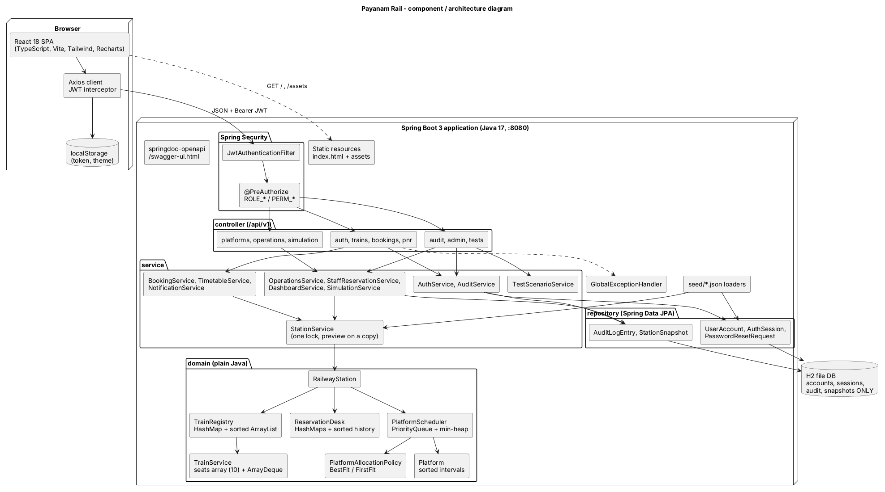
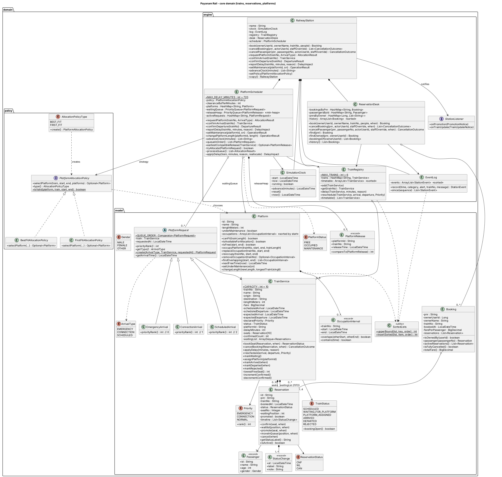

# Payanam Rail: Railway Reservation and Platform Allocation System

**Mini Project 16** · Core technologies: Java, Object-Oriented Programming, Data Structures

| | |
|---|---|
| Product | Payanam Rail, for the fictional single station *Payanam Junction* |
| Backend | Java 17, Spring Boot 3.3, Spring Security (JWT, BCrypt), Spring Data JPA, H2 (file mode) |
| Frontend | React 18, TypeScript, Vite, Tailwind CSS, Recharts, React Router, Axios |
| Testing | JUnit 5, Mockito, Spring Boot Test, JaCoCo, Vitest |
| Size | 160 Java source files (8,300 lines), 16 test files (2,000 lines), 71 TypeScript files (5,500 lines) |

## Contents

1. [Abstract](#1-abstract)
2. [Introduction](#2-introduction)
3. [Objectives](#3-objectives)
4. [System design](#4-system-design)
5. [Implementation](#5-implementation)
6. [Screenshot checklist](#6-screenshot-checklist)
7. [Results](#7-results)
8. [Limitations](#8-limitations)
9. [Future enhancements](#9-future-enhancements)
10. [Sustainable Development Goals](#10-sustainable-development-goals)
11. [Conclusion](#11-conclusion)
12. [References](#12-references)

---

## 1. Abstract

Payanam Junction manages seat reservations and its platform plan by hand. Cancelled seats are not offered promptly to
waiting passengers, a platform can be planned for two overlapping trains, a single delay can invalidate the whole
plan, and urgent trains may wait behind ordinary ones. Payanam Rail is a web application that automates both jobs for
one station with three platforms and six train services, each with ten seats.

The core is a plain Java domain model built on hand-written data-structure logic: a fixed seat array and an
`ArrayDeque` give every train first-come-first-served waiting-list promotion into the exact freed seat; a
`PriorityQueue` orders trains waiting for a platform by priority, arrival time and train number; a min-heap of
platform release times drives automatic allocation when platforms free up; sorted `ArrayList`s with binary-search
insertion keep each platform's occupation intervals ordered so that an overlap check takes O(log n); and `HashMap`s
give O(1) lookup of trains, PNRs, passengers and platforms. Platform choice is a pluggable policy (Best Fit by default,
First Fit as an alternative), and object-oriented design (encapsulation, inheritance, polymorphism, abstraction,
composition) keeps every business rule inside the class that owns the data.

Around this core, a Spring Boot REST API with JWT security serves two React portals: a passenger portal for booking,
cancellation, PNR status, e-tickets and live status, and a station operations portal with a control centre, a Gantt
platform board, delay impact previews, reservations management, a simulation clock, an audit log and a one-click Test
Lab. 129 automated tests pass, with 95–100% line coverage of the domain and service layers.

## 2. Introduction

### 2.1 Background

A railway station has two closely linked scheduling problems. On the commercial side, seats are limited and demand
exceeds supply, so a waiting list is kept; fairness demands that the passenger who waited longest is served first the
moment a seat is released. On the operational side, each arriving train needs a platform that is long enough and free
for the whole time the train stands there, including a safety clearance after it leaves. Both problems change
continuously: passengers cancel, trains run late, platforms go into maintenance.

### 2.2 Problems in the current manual process

| Problem (case study) | Impact |
|---|---|
| Cancelled seats are not promptly offered to waiting passengers | Lost revenue and unfair treatment of waitlisted passengers |
| A platform may be assigned to overlapping train intervals | Safety risk and last-minute platform changes |
| Delays can invalidate a prepared platform plan | Conflicts are discovered only when trains arrive |
| Connecting or declared emergency trains may need priority | Urgent trains wait while ordinary trains occupy platforms |

### 2.3 Scope

One station, at most six train services, three platforms (P1 600 m, P2 450 m, P3 300 m), one seat class of exactly ten
seats per train, one end-to-end booking segment, one to four passengers per PNR, a ten-minute clearance buffer and a
simulation clock that represents "now". Arrivals, departures, delays and cancellations are entered manually by staff.
There are no external APIs and no payment gateway: the fare is shown for information only. The detailed analysis is
in [problem-analysis.md](problem-analysis.md).

## 3. Objectives

1. Book 1–4 passengers per PNR with a confirmed seat (CNF/S1–S10) while seats last and a FIFO waiting list (WL/n)
   afterwards (R1, R2).
2. On every cancellation, give the freed seat immediately to the oldest waiting passenger and notify them; allow
   partial cancellation and reject invalid ones (R3–R5); close booking once the train has arrived (R6).
3. Allocate a platform only if it is long enough, in service and free for `[arrival, departure + buffer)`; reject
   overlong trains; queue the rest by priority, arrival time and train number (P1–P4).
4. Never displace a train that is on a platform; re-plan later trains automatically after a delay, a departure or
   maintenance (P5, P7–P9); support Best Fit and First Fit policies (P6).
5. Demonstrate Java OOP and data structures clearly enough to be explained line by line in a viva.
6. Deliver it as a secure, role-based, production-style web application with automated tests and documentation.

## 4. System design

### 4.1 Architecture

A single Spring Boot process serves the React single-page application, the REST API under `/api/v1` and Swagger UI.
The layers are:

| Layer | Responsibility |
|---|---|
| React SPA | Two portals with route guards, an Axios client that attaches the JWT and signs out on 401 |
| Security | `JwtAuthenticationFilter` (signature, expiry, session not revoked) and `@PreAuthorize` permissions |
| Controllers | HTTP mapping, Bean Validation of request DTOs; return response DTOs only |
| Services | Use cases, auditing, mapping domain objects to DTOs, the station lock and previews |
| Domain | Plain Java classes for trains, reservations, platforms, requests and policies; all rules R1–R6, P1–P9 |
| Repositories | JPA repositories for accounts, sessions, OTPs, audit log and snapshots only |

Mermaid and PlantUML sources: [architecture.md](architecture.md), [architecture.puml](architecture.puml).

### 4.2 Class design

| OOP concept | Where |
|---|---|
| Classes and objects | `TrainService`, `Passenger`, `Reservation`, `Booking`, `Platform`, `PlatformRequest`, `RailwayStation` |
| Encapsulation | `TrainService.bookSeat()` / `cancelBooking()` guard the seat count 0–10; `Platform.occupyPlatform()` guards non-overlap; no rule-breaking setters |
| Inheritance and polymorphism | `PlatformRequest` → `EmergencyArrival`, `ConnectionArrival`, `ScheduledArrival`, each overriding `priorityRank()`; `UserAccount` → `PassengerUser`, `StationStaffUser` |
| Abstraction | `PlatformAllocationPolicy` interface → `BestFitAllocationPolicy`, `FirstFitAllocationPolicy` (strategy pattern) |
| Composition | `TrainService` owns its seat array and waiting `ArrayDeque`; `RailwayStation` owns its registry, desk, scheduler, clock and log |
| Enums | `Priority`, `TrainStatus`, `ReservationStatus`, `PlatformStatus`, `ArrivalType`, `Role`, `StaffDesignation`, `Permission` |
| Custom exceptions | `TrainNotFoundException`, `SeatUnavailableException`, `InvalidCancellationException`, `PlatformConflictException`, `UnauthorizedActionException`, … |

User, security and exception diagrams: [uml-class-diagram.md](uml-class-diagram.md) and
[uml-class-diagram.puml](uml-class-diagram.puml).

### 4.3 Data structures

| Structure | Use | Main cost |
|---|---|---|
| `HashMap` | trains, PNRs, passengers, platforms, an account's PNRs | O(1) lookup |
| `Reservation[10]` | the seats of a train | O(1) seat access |
| `ArrayDeque` | FIFO waiting list per train | O(1) add / promote |
| `PriorityQueue` | trains waiting for a platform | O(log n) add / poll |
| Min-heap (`PriorityQueue<PlatformRelease>`) | next platform release, compatibility check | O(1) peek |
| Sorted `ArrayList` + binary search | platform intervals, timetable, booking history, event log | O(log n) overlap check |

Full discussion with alternatives: [data-structures.md](data-structures.md).

### 4.4 Key algorithms

**Booking (R1).** If `confirmedCount < 10`, put the ticket in the lowest free seat; otherwise `waitingList.addLast()`.

**Cancellation and promotion (R3).** Free seat k; `promoted = waitingList.pollFirst()`; if present, `seats[k] =
promoted`, renumber the rest, notify the owner.

**Platform request (P1–P4, P6).** Reject if longer than the longest platform. Otherwise ask the policy for a platform
that is in service, long enough and free for `[arrival, departure + buffer)`. Best Fit chooses the shortest such
platform (tie: lowest id). If found, occupy it and push its release time on the min-heap; if not, add the request to
the priority queue.

**Serving the queue.** After a departure, a clock advance, a delay or maintenance: poll every waiting request in
priority order, try to allocate it once, and put back those that still do not fit, so a long train never blocks a
shorter, lower-ranked one.

**Delay (P7).** A queued train is removed, its times are changed, and it is reinserted. An assigned or arrived train has
its interval extended; later, not-yet-arrived trains that now overlap are un-assigned, re-queued and re-allocated, each
with an alert. A train on a platform is never moved (P5).

Sequence diagrams for Book, Cancel → Promote, Arrival → Allocate and Delay → Reallocate are in
[architecture.md](architecture.md#2-sequence-book-a-ticket-r1-r2-r6).

### 4.5 Persistence

The case study does not need a database: every rule runs on the in-memory collections. A real sign-in system does need
persistent accounts, so an H2 database in file mode (`backend/data/payanam-rail.mv.db`) holds only:

| Table | Content |
|---|---|
| `user_account` | passengers and staff (single-table inheritance), BCrypt hashes, lockout counters |
| `auth_session` | one row per JWT (`jti`), for logout and expiry |
| `password_reset_request` | hashed OTP, expiry, attempts |
| `audit_log` | who did what, when (real and simulation time), success flag |
| `station_snapshot` | saved KPIs and plan as JSON |

### 4.6 Security design

* Passwords: BCrypt; at least 8 characters with upper and lower case, a digit and a special character.
* Sign-in by email or mobile; 5 wrong passwords lock the account for 15 minutes.
* JWT valid for 60 minutes (7 days with *remember me*); the client signs out automatically at expiry; logout revokes
  the session row so the token stops working at once.
* Roles `PASSENGER` and `STATION_STAFF`; staff permissions by designation (Station Master: all; Platform Controller:
  platforms, trains, simulation; Booking Clerk: reservations). Enforced by URL rules and `@PreAuthorize`, mirrored by
  hidden menu items and route guards in React.
* Staff registration needs the station access code from `application.yml` (`PAYANAM-2026`), an employee id
  `PJ-EMP-XXXX` and an official `@payanam.in` email.
* Forgot password is simulated: the 6-digit OTP is shown on screen and logged, stored hashed, valid 10 minutes.

### 4.7 User interface

A corporate design system in navy and teal with Inter, white cards, soft shadows, light and dark themes, a collapsible
sidebar, a top bar with global search (Ctrl+K), the simulation clock, notifications and the profile menu. Components:
KPI cards, sortable and searchable data tables with pagination, status badges (CNF green, WL amber, CAN grey, REJECTED
and EMERGENCY red, CONNECTION violet), modals, toasts, skeleton loaders, empty states and 403/404 pages. All pages are
responsive down to phone width.

## 5. Implementation

### 5.1 Backend packages

| Package | Contents |
|---|---|
| `domain.model` | `TrainService`, `Reservation`, `Passenger`, `Booking`, `Platform`, `OccupationInterval`, `PlatformRequest` and subclasses, `PlatformRelease`, enums, `SortedLists` |
| `domain.engine` | `RailwayStation`, `TrainRegistry`, `ReservationDesk`, `PlatformScheduler`, `SimulationClock`, `EventLog`, result records |
| `domain.policy` | `PlatformAllocationPolicy`, `BestFitAllocationPolicy`, `FirstFitAllocationPolicy` |
| `domain.user`, `domain.audit` | JPA entities for accounts, sessions, OTPs, audit entries, snapshots |
| `service`, `service.testlab` | use cases; `StationService` owns the live station; `TestScenarioService` runs the lab |
| `controller` | 12 REST controllers under `/api/v1` ([api.md](api.md)) |
| `security`, `config`, `exception`, `seed` | JWT, configuration, error handling, seed loaders |

### 5.2 Concurrency and previews

All reads and writes of the live station go through `StationService.read()` / `write()`, which hold the station's
lock, so a promotion or an allocation can never interleave with another request. Impact previews run the real
algorithm on `station.copy()`, a deep copy, and throw it away; the live station is not touched.

### 5.3 Seed data

`src/main/resources/seed/*.json`: 3 platforms, 6 trains (Vaigai Express 12635, Guruvayur Express 16127 CONNECTION,
Medical Relief Special 06055 EMERGENCY, Pearl City Express 12693, Tejas Express 22671, Pandian Express 12637 at 650 m
for the overlong case), 15 passenger accounts and 3 staff accounts, and 32 PNRs, so that Vaigai and Pearl City are full
with waiting lists. At start-up four trains request platforms, which produces a queued emergency train.

### 5.4 Frontend

| Area | Pages |
|---|---|
| Public | Landing, Sign in / Sign up (Passenger and Station Staff tabs), Forgot password, public PNR status, 403, 404 |
| Passenger (`/passenger`) | Dashboard, Search & Timetable, Book Ticket (3-step wizard), My Bookings, Booking detail, E-ticket (QR, print to PDF), PNR status, Live train status, Seat map, Notifications, Profile |
| Station (`/station`) | Control Centre, Platform Board (cards + Gantt), Platform Queue, Arrival Requests, Train Operations, Reservations, Timetable, Platforms, Simulation, Audit Log, Test Lab, Settings |

### 5.5 Build and run

`frontend-maven-plugin` installs Node 20 into `target/`, runs `npm install` and `npm run build`, and the build is copied into
the jar's `static/` folder, so `./mvnw spring-boot:run` builds and serves everything on port 8080. Dev mode runs Vite on
port 5173 with a proxy to 8080. See the [README](../README.md).

## 6. Screenshot checklist

Captured screenshots are in [screenshots/](screenshots/). Take fresh ones in the same order for the printed report.

| # | Screen | How to reach it | File |
|---|---|---|---|
| 1 | Landing page | `/` | `screenshots/01-landing.png` |
| 2 | Sign in (with demo accounts) | `/signin` | `screenshots/02-signin.png` |
| 3 | Sign up validation errors | `/signup`, submit an empty form | `screenshots/03-signup-validation.png` |
| 4 | Passenger dashboard | sign in as passenger | `screenshots/04-passenger-dashboard.png` |
| 5 | Search & timetable | Search trains | `screenshots/05-search.png` |
| 6 | Book ticket, review step | Book → train → passengers → Review | `screenshots/06-book-review.png` |
| 7 | Booking success (PNR, CNF/WL) | Confirm | `screenshots/07-book-success.png` |
| 8 | My Bookings | My Bookings | `screenshots/08-my-bookings.png` |
| 9 | Booking detail with timeline | open a PNR | `screenshots/09-booking-detail.png` |
| 10 | E-ticket with QR code | E-ticket | `screenshots/10-eticket.png` |
| 11 | PNR status | PNR status | `screenshots/11-pnr-status.png` |
| 12 | Live train status | Live status | `screenshots/12-live-status.png` |
| 13 | Seat map | Seat map | `screenshots/13-seat-map.png` |
| 14 | Notifications (promotion, delay) | Notifications | `screenshots/14-notifications.png` |
| 15 | Profile | Profile | `screenshots/15-profile.png` |
| 16 | Control Centre | sign in as Station Master | `screenshots/16-control-centre.png` |
| 17 | Platform Board with Gantt | Platform Board | `screenshots/17-platform-board.png` |
| 18 | Platform Queue | Platform Queue | `screenshots/18-platform-queue.png` |
| 19 | Arrival Requests (queued, rejected) | Arrival Requests | `screenshots/19-arrival-requests.png` |
| 20 | Delay impact preview | Train Operations → Delay → Preview | `screenshots/20-delay-preview.png` |
| 21 | Reservations (seats, FIFO, promotions) | Reservations | `screenshots/21-reservations.png` |
| 22 | Timetable management | Timetable | `screenshots/22-timetable.png` |
| 23 | Platform management | Platforms | `screenshots/23-platforms.png` |
| 24 | Simulation control | Simulation | `screenshots/24-simulation.png` |
| 25 | Audit log | Audit Log | `screenshots/25-audit-log.png` |
| 26 | Test Lab, 11/11 PASS | Test Lab → Run all | `screenshots/26-test-lab.png` |
| 27 | Settings (policy, buffer) | Settings | `screenshots/27-settings.png` |
| 28 | 403 for a Booking Clerk | clerk opens `/station/board` | `screenshots/28-forbidden.png` |
| 29 | Dark mode | theme toggle | `screenshots/29-dark-mode.png` |
| 30 | Mobile layout | phone width | `screenshots/30-mobile.png` |
| 31 | Swagger UI | `/swagger-ui.html` | `screenshots/31-swagger.png` |
| 32 | JaCoCo report | `backend/target/site/jacoco/index.html` | take after `./mvnw test` |

## 7. Results

### 7.1 Functional results

Every rule from the case study is implemented in the domain layer and checked by tests; the full table with input,
expected and actual values is in [test-results.md](test-results.md).

| Area | Result |
|---|---|
| R1–R6 reservations | CNF/S1–S10 then WL/n; 1–4 passengers per PNR; promotion of the oldest WL into the exact freed seat with a notification; partial cancellation; invalid actions refused with clear errors; booking closed after arrival |
| P1–P9 platforms | no overlap on any platform; overlong train rejected; busy platforms queue the train; emergency → connection → normal → arrival → train number; arrived trains never displaced; Best Fit / First Fit switchable; delays re-plan later trains with alerts; departures release at departure + 10 min and allocate the queue; maintenance excludes a platform |
| Test Lab | T1–T7 and F1–F4 all PASS from the UI, each on an isolated station |
| Security | sign-up validation, lockout after 5 failures, JWT expiry and logout revocation, 403 for wrong role or permission |

### 7.2 Test and coverage results

| Measure | Value |
|---|---|
| Backend tests | 129 passed, 0 failed (14 test classes) |
| Frontend tests | 12 passed (Vitest) |
| JaCoCo line coverage | `domain.engine` 98.0%, `domain.model` 97.1%, `domain.policy` 100%, `domain.user` 95.4%, `service` 95.1%, `service.testlab` 92.5% |
| Coverage gate | build fails below 80% on domain and service |

### 7.3 Example run (seed data)

| Step | Outcome |
|---|---|
| Start-up, clock 06:30 | Vaigai → P2, Guruvayur → P1, Tejas → P3, Medical Relief Special queued (only P1 is long enough) |
| Pearl City requests a platform | Queued at position 2 behind the emergency train; next compatible release P2 at 07:25 |
| Pandian Express requests a platform | Rejected: 650 m exceeds every platform |
| Clerk cancels Vaigai S1 | Arun Kumar promoted WL/1 → CNF/S1, notified; WL/2 becomes WL/1 |
| Guruvayur delayed 15 min | P1 occupation extended to 07:45; the emergency train's next release moves to 07:45 |
| Vaigai arrives and departs at 07:00 | P2 released at 07:10; Pearl City allocated P2 from the queue automatically |

## 8. Limitations

* **Single station.** There is no network of stations, routing or multi-segment journeys.
* **In-memory state.** Trains and bookings are reloaded from the seed when the server restarts; only accounts, the
  audit log and snapshots persist. A single JVM lock serialises station updates, which is fine for one station but
  would not scale to many.
* **One seat class, one segment, ten seats.** Fixed by the case study; quotas, berths and fares by distance are out of
  scope.
* **Manual operations.** Arrivals, departures and delays are confirmed by staff against a simulation clock, not read
  from live train positions.
* **Simulated services.** No payment, and the password-reset OTP is shown on screen instead of being sent by SMS or
  e-mail. In-app notifications only.
* **Demo secrets.** The JWT key and station access code are in `application.yml` and must be replaced (environment
  variables) for any real deployment.

## 9. Future enhancements

| Enhancement | Approach |
|---|---|
| Multi-station graph routing | Model stations as graph nodes and track sections as weighted edges; search routes with Dijkstra or A*; seat inventory per segment so one seat can be sold to non-overlapping journeys |
| Real payment | Integrate a payment gateway (e.g. UPI) with a pending → paid → ticketed state machine, refunds on cancellation and idempotent callbacks |
| SMS / e-mail | Send promotion, delay and platform-change alerts and the OTP through an SMS or e-mail provider via an outbox table and a background sender |
| Live train feeds | Replace manual arrival and delay entry with live position data, so P7 re-planning starts automatically |
| Mobile app | A React Native or PWA client reusing the same `/api/v1`, with push notifications |
| Scale-out | Persist the station state in a relational database with optimistic locking, or partition by station |
| Analytics | Historical occupancy and delay reports to tune the clearance buffer and timetable |

## 10. Sustainable Development Goals

**SDG 9 – Industry, Innovation and Infrastructure.** Platforms are expensive infrastructure. Best Fit allocation keeps
long platforms free for long trains, and automatic re-planning after delays avoids conflicts without building new
capacity. Digital, auditable operations (event log, audit log, snapshots) are the kind of resilient, data-driven
infrastructure management that SDG 9 targets (9.1: reliable, sustainable and resilient infrastructure).

**SDG 11 – Sustainable Cities and Communities.** Rail is the most sustainable way to move many people between and
within cities. Filling every cancelled seat from the waiting list at once, giving passengers live platform and delay
information, and serving emergency trains first make public transport more reliable, fairer and more attractive than
road travel (11.2: safe, affordable, accessible and sustainable transport systems for all).

## 11. Conclusion

Payanam Rail turns the manual reservation register and platform chart of Payanam Junction into one consistent system.
Each problem in the case study is solved by a specific, explainable piece of code: a FIFO deque for fair promotion, a
sorted interval list with binary search for overlap-free platforms, a priority queue for urgent trains, a min-heap of
release times for automatic allocation, and a remove-and-reinsert rule that keeps the queues correct when delays change
their keys. Object-oriented design keeps each rule inside the class that owns the data, so it cannot be bypassed.
The secure, role-based web application, the impact previews, the Test Lab and 129 passing tests show that these rules
hold in practice, and the documentation explains every design choice for review.

## 12. References

1. Cormen, Leiserson, Rivest, Stein. *Introduction to Algorithms*, 4th ed., MIT Press: heaps, priority queues, binary
   search.
2. Oracle. *Java SE 17 API*: `java.util.ArrayDeque`, `PriorityQueue`, `HashMap`, `ArrayList`.
3. Spring. *Spring Boot 3 Reference* and *Spring Security Reference*.
4. React. *react.dev* documentation; Vite and Tailwind CSS documentation.
5. OWASP. *Authentication Cheat Sheet* and *Password Storage Cheat Sheet*.
6. United Nations. *Sustainable Development Goals 9 and 11*, sdgs.un.org.
