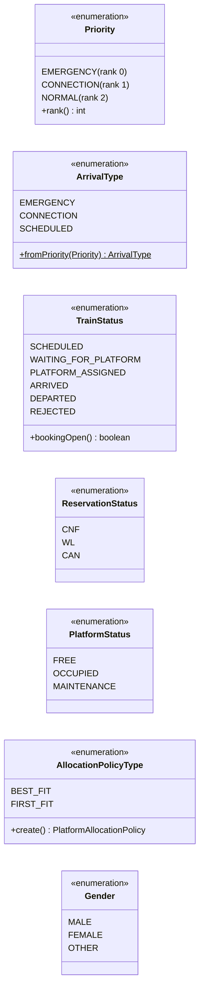
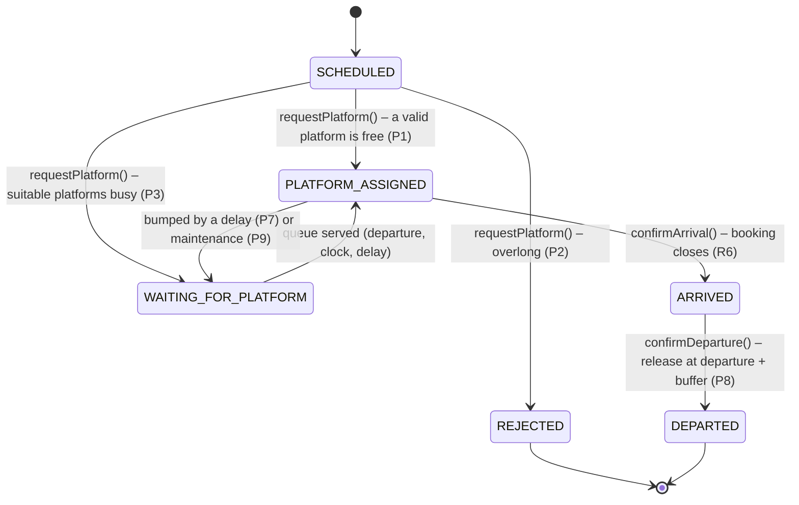
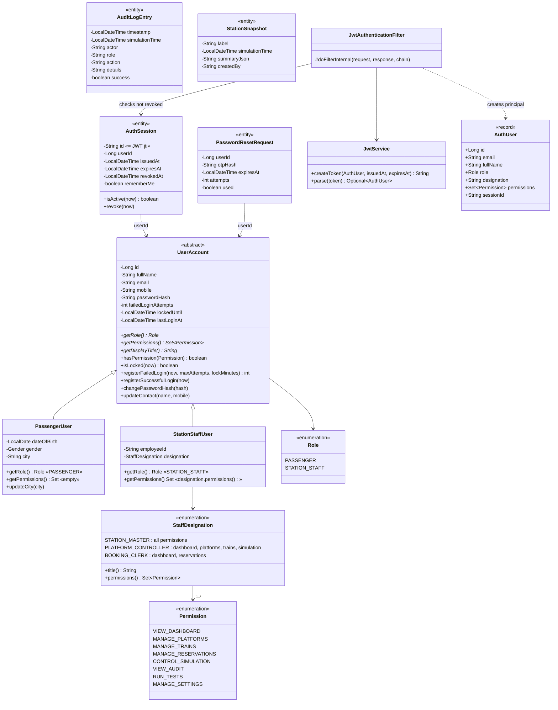
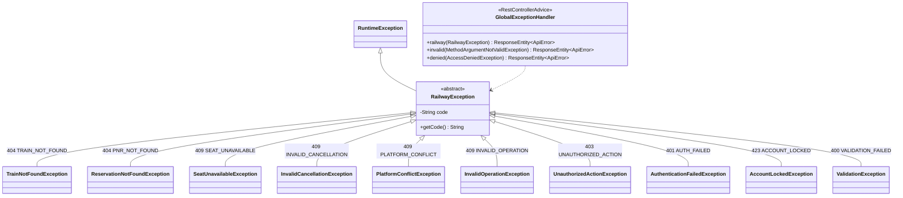
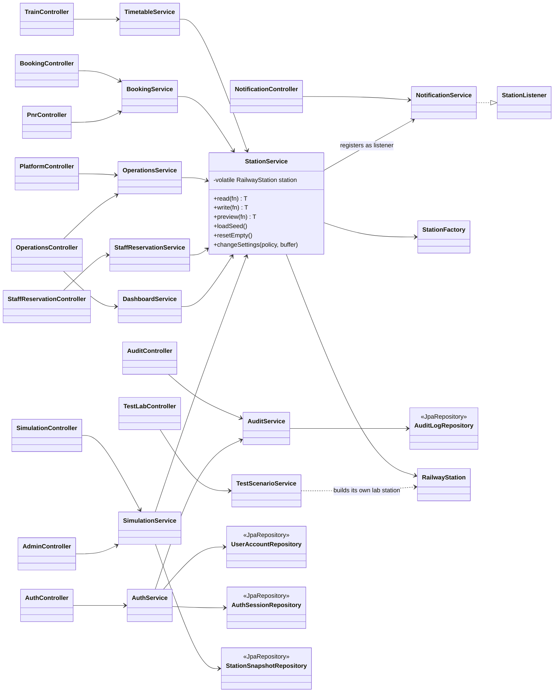

# UML class diagrams

The same model is also available as PlantUML in [uml-class-diagram.puml](uml-class-diagram.puml).
The architecture (component) diagram and the sequence diagrams are in [architecture.md](architecture.md).

Notation: `<|--` inheritance, `<|..` implements an interface, `*--` composition (the part cannot exist without the
whole), `o--` aggregation, `-->` association / dependency. Getters are left out to keep the diagrams readable.

## 1. Core domain: trains, reservations and platforms

```mermaid
classDiagram
    direction TB

    class RailwayStation {
        -String name
        -SimulationClock clock
        -EventLog log
        -TrainRegistry registry
        -ReservationDesk desk
        -PlatformScheduler scheduler
        +book(ownerUserId, ownerName, trainNo, people) Booking
        +cancelBooking(pnr, actorUserId, staffOverride) List~CancellationOutcome~
        +cancelPassenger(pnr, passengerNo, actorUserId, staffOverride) CancellationOutcome
        +requestPlatform(trainNo, ArrivalType) AllocationResult
        +confirmArrival(trainNo) TrainService
        +confirmDeparture(trainNo) DepartureResult
        +reportDelay(trainNo, minutes, reason) DelayImpact
        +setMaintenance(platformId, boolean) OperationResult
        +advanceClock(minutes) List~String~
        +setPolicy(PlatformAllocationPolicy)
        +copy() RailwayStation
    }

    class TrainRegistry {
        +MAX_TRAINS = 6$
        -HashMap~String,TrainService~ trains
        -ArrayList~TrainService~ timetable
        +add(TrainService)
        +get(trainNo) TrainService
        +delay(TrainService, minutes, reason)
        +reschedule(TrainService, arrival, departure, Priority)
        +timetable() List~TrainService~
    }

    class TrainService {
        +CAPACITY = 10$
        -String trainNo
        -String name
        -String origin
        -String destination
        -int lengthMeters
        -BigDecimal fare
        -LocalDateTime scheduledArrival
        -LocalDateTime scheduledDeparture
        -LocalDateTime expectedArrival
        -LocalDateTime expectedDeparture
        -Priority declaredPriority
        -TrainStatus status
        -String platformId
        -int delayMinutes
        -Reservation[] seats
        -int confirmedCount
        -ArrayDeque~Reservation~ waitingList
        +bookSeat(Reservation, when) ReservationStatus
        +cancelBooking(Reservation, when) CancellationOutcome
        +applyDelay(minutes, reason)
        +reschedule(arrival, departure, Priority)
        +markWaiting()
        +assignPlatform(platformId)
        +markArrived(when)
        +markDeparted(when)
        +markRejected()
        -lowestFreeSeat() int
        -incrementConfirmed()
        -decrementConfirmed()
    }

    class Reservation {
        -String id
        -String pnr
        -String trainNo
        -LocalDateTime bookedAt
        -ReservationStatus status
        -Integer seatNo
        -int waitingPosition
        -boolean promoted
        -List~StatusChange~ timeline
        ~confirm(seat, when)
        ~waitlist(position, when)
        ~promote(seat, when)
        ~moveInQueue(position, when)
        ~cancel(when)
        +getStatusLabel() String
        +isActive() boolean
    }

    class Passenger {
        <<record>>
        +String id
        +String name
        +int age
        +Gender gender
    }

    class StatusChange {
        <<record>>
        +LocalDateTime at
        +String label
        +String note
    }

    class Booking {
        -String pnr
        -Long ownerUserId
        -String ownerName
        -String trainNo
        -LocalDateTime bookedAt
        -BigDecimal farePerPassenger
        -List~Reservation~ reservations
        +isOwnedBy(userId) boolean
        +passenger(passengerNo) Reservation
        +activeReservations() List~Reservation~
        +isFullyCancelled() boolean
        +totalFare() BigDecimal
    }

    class ReservationDesk {
        -HashMap~String,Booking~ bookingsByPnr
        -HashMap~String,Passenger~ passengersById
        -HashMap~Long,List~ pnrsByOwner
        -ArrayList~Booking~ history
        +book(ownerUserId, ownerName, trainNo, people, when) Booking
        +cancelBooking(pnr, actorUserId, staffOverride, when) List~CancellationOutcome~
        +cancelPassenger(pnr, passengerNo, actorUserId, staffOverride, when) CancellationOutcome
        +find(pnr) Booking
        +findOwned(pnr, ownerUserId) Booking
        +bookingsOf(ownerUserId) List~Booking~
        +history() List~Booking~
    }

    class PlatformScheduler {
        +MAX_DELAY_MINUTES = 720$
        -PlatformAllocationPolicy policy
        -int clearanceBufferMinutes
        -HashMap~String,Platform~ platforms
        -PriorityQueue~PlatformRequest~ waitingQueue
        -PriorityQueue~PlatformRelease~ releaseHeap
        -HashMap~String,PlatformRequest~ activeRequests
        +requestPlatform(trainNo, ArrivalType) AllocationResult
        +confirmArrival(trainNo) TrainService
        +confirmDeparture(trainNo) DepartureResult
        +reportDelay(trainNo, minutes, reason) DelayImpact
        +setMaintenance(platformId, boolean) OperationResult
        +changePlatformLength(platformId, length) OperationResult
        +advanceClock(minutes) List~String~
        +queueInOrder() List~PlatformRequest~
        +earliestCompatibleRelease(TrainService) Optional~PlatformRelease~
        -tryAllocate(PlatformRequest) boolean
        ~processQueue() List~AllocationResult~
        ~applyDelay(train, minutes, reason, reallocate) DelayImpact
    }

    class Platform {
        -String id
        -String name
        -int lengthMeters
        -boolean underMaintenance
        -ArrayList~OccupationInterval~ occupations
        +canFit(trainLength) boolean
        +isAvailableForAllocation() boolean
        +isFree(start, end) boolean
        +occupyPlatform(trainNo, start, end, trainLength)
        +replaceOccupation(trainNo, start, end)
        +reoccupy(trainNo, start, end)
        +removeOccupation(trainNo) Optional~OccupationInterval~
        +findOverlapping(start, end) List~OccupationInterval~
        +nextFreeTime(now) LocalDateTime
        +setUnderMaintenance(boolean)
        +changeLength(newLength, longestTrainUsingIt)
    }

    class OccupationInterval {
        <<record>>
        +String trainNo
        +LocalDateTime start
        +LocalDateTime end
        +overlaps(otherStart, otherEnd) boolean
        +contains(time) boolean
    }

    class PlatformRelease {
        <<record>>
        +String platformId
        +String trainNo
        +LocalDateTime releaseTime
        +compareTo(PlatformRelease) int
    }

    class PlatformRequest {
        <<abstract>>
        +QUEUE_ORDER$ Comparator
        -TrainService train
        -LocalDateTime requestedAt
        +priorityRank()* int
        +getType()* ArrivalType
        +create(ArrivalType, TrainService, requestedAt)$ PlatformRequest
        +getArrivalTime() LocalDateTime
    }
    class EmergencyArrival {
        +priorityRank() int  «0»
    }
    class ConnectionArrival {
        +priorityRank() int  «1»
    }
    class ScheduledArrival {
        +priorityRank() int  «2»
    }

    class PlatformAllocationPolicy {
        <<interface>>
        +selectPlatform(train, start, end, platforms) Optional~Platform~
        +type() AllocationPolicyType
        +isValid(platform, train, start, end)$ boolean
    }
    class BestFitAllocationPolicy {
        +selectPlatform(...) Optional~Platform~
    }
    class FirstFitAllocationPolicy {
        +selectPlatform(...) Optional~Platform~
    }

    class SimulationClock {
        -LocalDateTime start
        -LocalDateTime now
        -boolean running
        +advance(minutes) LocalDateTime
        +reset()
        +now() LocalDateTime
    }

    class EventLog {
        -ArrayList~StationEvent~ events
        +record(time, category, alert, trainNo, message) StationEvent
        +since(sequence) List~StationEvent~
    }

    class StationListener {
        <<interface>>
        +onPromotion(PromotionNotice)
        +onTrainUpdate(TrainUpdateNotice)
    }

    class SortedLists {
        <<utility>>
        +upperBound(list, key, order)$ int
        +insertSorted(list, item, order)$ int
    }

    RailwayStation *-- SimulationClock
    RailwayStation *-- EventLog
    RailwayStation *-- TrainRegistry
    RailwayStation *-- ReservationDesk
    RailwayStation *-- PlatformScheduler
    RailwayStation --> StationListener : notifies

    TrainRegistry o-- "0..6" TrainService
    TrainService *-- "0..10 seats" Reservation
    TrainService *-- "0..* waitingList (FIFO)" Reservation
    TrainService --> Priority
    TrainService --> TrainStatus

    Reservation --> "1" Passenger
    Reservation *-- "1..*" StatusChange
    Reservation --> ReservationStatus
    Booking o-- "1..4" Reservation
    ReservationDesk o-- "0..*" Booking
    ReservationDesk --> TrainRegistry
    ReservationDesk --> EventLog

    PlatformScheduler o-- "3" Platform
    PlatformScheduler o-- "0..*" PlatformRequest : waitingQueue
    PlatformScheduler *-- "0..*" PlatformRelease : releaseHeap
    PlatformScheduler --> PlatformAllocationPolicy : strategy
    PlatformScheduler --> TrainRegistry
    PlatformScheduler --> SimulationClock
    Platform *-- "0..*" OccupationInterval
    Platform ..> SortedLists
    TrainRegistry ..> SortedLists
    EventLog ..> SortedLists

    PlatformRequest <|-- EmergencyArrival
    PlatformRequest <|-- ConnectionArrival
    PlatformRequest <|-- ScheduledArrival
    PlatformRequest --> "1" TrainService

    PlatformAllocationPolicy <|.. BestFitAllocationPolicy
    PlatformAllocationPolicy <|.. FirstFitAllocationPolicy
    PlatformAllocationPolicy ..> Platform : chooses
```

### Enums of the domain

### Train status life cycle

## 2. Users, roles and security

`UserAccount` is a JPA entity with single-table inheritance (`account_type` = `PASSENGER` / `STAFF`). Each subclass
overrides `getRole()`, `getPermissions()` and `getDisplayTitle()`, so the security layer never needs an `if` on the
user type.

## 3. Exceptions

All business errors extend one abstract base that carries a machine-readable `code`. The `GlobalExceptionHandler`
turns each into the same JSON body with the right HTTP status.

## 4. Layers: controllers, services, repositories

Controllers only translate HTTP to service calls and DTOs. Services hold the use cases and are the only code that
touches the `RailwayStation` (through `StationService`, which owns the lock) or the repositories. Domain objects
never leave the service layer: every response is a DTO record.

